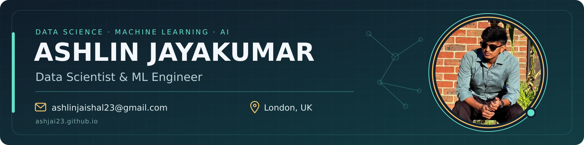
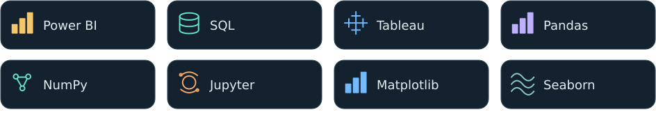

## Hi there 👋
I'm **Ashlin Jayakumar**, a data scientist and ML engineer based in **London, UK**, with an **MSc in Data Science from the University of Roehampton**. I build machine learning models, data pipelines, and dashboards that turn raw data into useful decisions.

My work spans fraud detection, cyber threat analysis, time-series forecasting, healthcare prediction, and analytics.

### Languages and Tools

**Programming, machine learning & development**

  

**Data science & analytics**

  

**AI tools & exploration**

  

### 🔭 What I work on
- **Machine learning & deep learning:** fraud detection, forecasting, classification, and model evaluation.
- **Cybersecurity & AI:** threat analysis using the VirusTotal API and MITRE ATT&CK.
- **Analytics & BI:** exploratory data analysis, Power BI and Tableau dashboards, KPI reporting, and data storytelling.
- **Data engineering:** SQL/Python pipelines, ETL workflows, and API integration.

### 🌱 Areas I explore
- Time-series modelling and deep learning with TensorFlow/Keras.
- Natural language processing and LLM-assisted analysis.
- AI tooling with ChatGPT, Hugging Face, LangChain, and MLflow.
- Cloud data workflows with AWS and PySpark.

### 👯 Let's collaborate on
- Open source projects in data science, machine learning, and analytics.
- Practical AI tools that make data easier to understand and use.

### 💬 Ask me about
- Python, SQL, Pandas, and Scikit-learn.
- Feature engineering, model evaluation, and visualising data.
- Turning business questions into dashboards and analytical workflows.

### 🎓 Background
- **MSc Data Science** — University of Roehampton, London.
- **BE Computer Science & Engineering** — St. Xavier's Catholic College of Engineering.
- **Certifications:** AWS Certified Cloud Practitioner · Google Data Analytics Professional Certificate.

---

  

  

### Workflows:
- **Python & SQL:** preparing, cleaning, and analysing structured data.
- **TensorFlow/Keras & Scikit-learn:** building and evaluating predictive models.
- **Power BI & Tableau:** translating analysis into dashboards and business insights.
- **Docker:** containerising data science and AI applications.
- **Flask & APIs:** connecting models and data services to applications.
- **AWS:** working with cloud data storage and processing workflows.

---

<!-- data-science-sprint:start -->
### 🚀 30-day data science sprint
**24 October–22 November 2026 · 6 of 44 projects completed**

[Explore the projects](projects/30-days/) · [30-day roadmap](projects/30-days/ROADMAP.md) · [Progress](projects/30-days/progress.json)

<!-- data-science-sprint:end -->

### Featured projects:

  
  

- **[Real-Time Cyber Threat Detection](https://github.com/AshJai23/JAIATD3)** — file and URL analysis, VirusTotal intelligence, MITRE ATT&CK integration, and AI-assisted chat.
- **[ATS Tracker](https://github.com/AshJai23/ats-tracker)** — a browser-based tool for CV diagnosis, job-description keywords, and AI-assisted rewriting.
- **[Python Assignments](https://github.com/AshJai23/Python-Assignments)** — Python practice and Jupyter notebooks.
- **[More data science projects →](https://ashjai23.github.io/#projects)** — fraud detection, forecasting, healthcare prediction, and visualisation.

### Connect with me:

📍 London, UK · Open to **Data Scientist, Data Analyst, and ML Engineer** roles.
