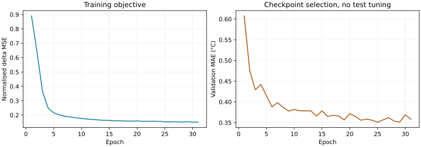
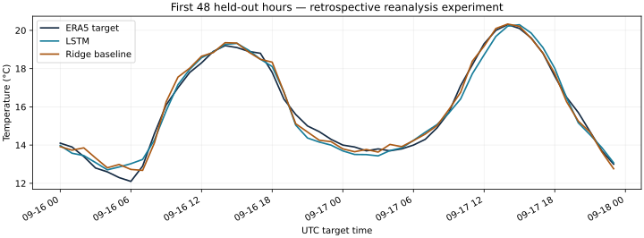

# London weather LSTM — a measured retail-exposure experiment

**Niche:** explore short-term temperature exposure relevant to UK retail planning.
**What it predicts:** the next hour's temperature at one London-area grid cell.
It does **not** predict shop sales, footfall, inventory, wind or storm events.

**Data mode:** 4,320 real, hourly **ERA5 reanalysis** records, downloaded through
Open-Meteo on **29 October 2026**, covering **25 April–21 October 2026**. The
last record was about **178.3 hours old** at capture. Reanalysis combines
observations and modelling retrospectively; it is neither live station data nor
an archive of forecasts issued at the time. This is a **historical experiment**,
not a deployed operational nowcast. Built with AI assistance.

## Run on a CPU

Python 3.12 was tested on Linux. In this project directory, create/activate a
virtual environment, then install the CPU wheel before the remaining pinned
requirements so a CUDA stack is not needed:

```bash
python -m venv .venv
source .venv/bin/activate
python -m pip install torch==2.14.1 --index-url https://download.pytorch.org/whl/cpu
python -m pip install -r requirements.txt
# Replay the actual trained weights; no retraining or network request:
python main.py --predict --input examples/source_snapshot.json --model examples/model.json --output outputs/replay
# Actually train the neural network again on the real saved source:
python main.py --train --input examples/source_snapshot.json --output outputs/trained
python -m unittest discover -s tests -v
# Download a fresh copy of this historical window, then train:
python main.py --train --live --end 2026-10-21 --days 180 --output outputs/downloaded
```

For PowerShell activation use `.venv\Scripts\Activate.ps1`. CPU wheel availability
varies by platform; use the [official installation selector](https://pytorch.org/get-started/locally/)
for your OS. Tested runtime: PyTorch **2.14.1+cpu**, NumPy **2.3.5**, scikit-learn
**1.8.0**, two CPU threads. No GPU, API key, paid service or model download is used.

Open `outputs/replay/report.html` from your file manager. This is a generated
report, not a public website. A GitHub source address opens code. No server,
always-on polling or public deployment has been installed.

## Actual held-out results

Each method predicts the **same 864 held-out hourly targets**, 16 September through
21 October. Lower error is better; temperatures are in °C.

| Method | MAE °C | RMSE °C |
|---|---:|---:|
| Trained LSTM | 0.4287 | 0.5608 |
| Repeat latest temperature | 0.6356 | 0.8477 |
| Repeat temperature 24 hours earlier | 2.5981 | 3.3324 |
| Simple trained Ridge baseline | **0.3485** | **0.4436** |

The LSTM beats persistence, but **Ridge wins overall**. No model changes were made
in response to these held-out results. This is one time window and one seed,
not evidence of consistent superiority, production skill or sales impact.





## Data and split

Requested point: **51.5074, −0.1278**. Returned grid coordinates: **51.5, −0.25**.
The grid is an approximation to the area, not a specific shop or weather station.
The request explicitly selects ERA5, UTC Unix timestamps and m/s wind units.
Inputs are temperature, relative humidity, wind speed and surface pressure,
plus sine/cosine of the UTC hour. Wind is an input, not a forecast target.

A sample consists of **24 consecutive past hours** and the next temperature.
A missing/invalid hour breaks the whole affected window; nothing is imputed.
There were no missing, duplicate, invalid or future rows in this source capture.

Boundaries are fixed from the requested calendar window, before filtering:

- Training targets before **11 August 00:00 UTC**: **2,568 sequences**.
- Validation targets from 11 August to before **16 September**: **864**.
- Test targets from **16 September** onwards: **864**.

Input means/scales use unique training-period hours only, and target-change
normalisation uses training samples only. Adjacent splits can reuse **earlier
observed context**, but every target belongs to just one split. No future target
is inserted into its own input. The source's reanalysis processing can itself
use later information, so this split is statistically chronological but does
**not** simulate operational data availability or forecast vintages.

## What was trained

One PyTorch `nn.LSTM` layer: 6 input features, **16 hidden units**, followed by a
linear head. **All 1,553 neural parameters are trainable**. The network learns a
normalised next-hour temperature change; adding that change to the latest known
temperature gives the prediction. There is no hosted chat API or pretrained model.

Adam with learning rate 0.003, batch size 256, gradient clipping at 1, seed 42,
maximum 40 epochs, and patience 6 were fixed before the test was evaluated.
Epoch **25** was selected by validation MAE; training stopped after **31** epochs.
The measured gradient-training/validation loop took **3.83 seconds** on this CPU,
excluding dependency installation, source download and plotting. Actual initial
and trained parameter hashes differ; the weights and learning curve are saved.

The Ridge comparator fits eight past-weather/change features on training samples
only. Neither it nor the LSTM uses test targets for fitting or selection.

## Outputs and useful limits

- [Model JSON](examples/model.json): actual learned weights, training-only scalers,
  split boundaries and trained linear-baseline parameters; no pickle.
- [Metrics](examples/metrics.json), [held-out predictions](examples/test_predictions.csv),
  [learning curve](examples/learning_curve.csv) and generated HTML report.
- [One-hour extrapolation example](examples/next_hour_example.json): after the
  final archived record, with a historical target date and unknown actual/error.
  It must not be presented as today's forecast.
- [Validation evidence](examples/validation.txt): tests, actual source provenance,
  model reload/replay and a repeated deterministic training check.

Saved-model prediction deliberately requires the **exact experiment snapshot**.
For a different data window, use `--train` explicitly; do not relabel in-sample or
new-window predictions as the old held-out evaluation. Synthetic fixtures are
used only in tests, never as the published training dataset or live fallback.

Pros: small, inspectable, reproducible CPU training, real neural weights, clear
baselines and source-age reporting. Cons: one location and a spring-to-autumn
sample; no independent year/location test, uncertainty intervals, real retail
outcomes, live feed or publication-delay simulation. The better linear baseline
and delayed reanalysis make this unsuitable for launching as a current commercial
weather or retail-demand service. It is useful as a portfolio prototype.

## Source, licence and attribution

[Open-Meteo historical API](https://open-meteo.com/en/docs/historical-weather-api),
[terms](https://open-meteo.com/en/terms),
[ERA5 dataset DOI](https://doi.org/10.24381/cds.adbb2d47).
Credit: **Open-Meteo / Patrick Zippenfenig**, and **Hersbach et al., ECMWF ERA5 / Copernicus
Climate Change Service**. Data is supplied through Open-Meteo under
[CC BY 4.0](https://creativecommons.org/licenses/by/4.0/). This project transforms
it into sequences and predictions; providers do not endorse the results.

The public free endpoint is used for this non-commercial educational experiment;
its terms limit commercial API use. ERA5 is regularly refreshed with publication
delay. This tool makes one bounded request, preserves the response, request URL,
units, capture date and original-response SHA-256, and never silently fabricates
replacement data. Documentation verified **29 October 2026**.

Implementation references: [PyTorch LSTM](https://docs.pytorch.org/docs/stable/generated/torch.nn.LSTM.html),
[reproducibility guidance](https://docs.pytorch.org/docs/stable/notes/randomness.html).
Optional plots: `python -m pip install -r requirements-plots.txt`, then
`python plot_results.py --output examples`; Matplotlib was used for the saved SVGs.
